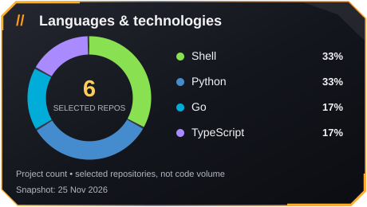

<!-- Independent developer profile theme -->

[Overview](#about) · [Top repositories](#top-repositories) · [Technologies](#technologies) · [GitHub activity](https://github.com/infinite667#contribution-activity) · [Dashboard source](index.html)

## About

## Top repositories

<b>Security research / project index</b>

- [Sinfi](https://github.com/infinite667/Sinfi): Wi-Fi auditing toolkit for Linux. Wireless security research.
- [DarkusSurf](https://github.com/infinite667/DarkusSurf): Tor connection management and network privacy tooling.
- [RedEyeMap](https://github.com/infinite667/RedEyeMap): Interactive extension and wrapper for Nmap.
- [Rogue-Cat](https://github.com/infinite667/Rogue-Cat): Security and vulnerability research. See repository for scope and details.
- [ConPty-Shell-One-Liner](https://github.com/infinite667/ConPty-Shell-One-Liner): Windows ConPty shell research. See repository for scope and details.
- [Notepad-RCE-via-Command-Injection](https://github.com/infinite667/Notepad-RCE-via-Command-Injection): Notepad command injection research. Vulnerability documentation.

Research and testing should be conducted only in authorized environments. See the individual repositories for project scope, licensing and security policies.

## Technologies & activity

Statistics snapshot: 25 November 2026. The language chart counts six selected projects with identifiable languages, not total source-code volume. The contribution graph is based on GitHub's public calendar. <a href="https://github.com/infinite667#contribution-activity">View current activity.</a>

<b>About this profile</b>

An independent developer profile design. Project cards are curated, not ranked by stars. The optional separate dashboard offers filtering, tabs and on-demand public GitHub data refresh. The yearly contribution chart is a dated snapshot.

