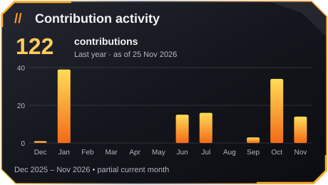

<!-- PROJECT: RENEKTON / Command Center — independent fan-inspired profile theme -->

[Overview](#command-center) · [Top repositories](#top-repositories) · [Technologies](#technologies) · [GitHub activity](https://github.com/infinite667#contribution-activity) · [Interactive dashboard](https://infinite667.github.io/infinite667/)

## Command Center

## Top repositories

<b>Security research / project index</b>

- [Sinfi](https://github.com/infinite667/Sinfi): Wi-Fi auditing toolkit for Linux. Wireless security research.
- [DarkusSurf](https://github.com/infinite667/DarkusSurf): Tor connection management and network privacy tooling.
- [RedEyeMap](https://github.com/infinite667/RedEyeMap): Interactive extension and wrapper for Nmap.
- [RogueCat](https://github.com/infinite667?tab=repositories&q=RogueCat): Vulnerability research collection. Repository link to be confirmed.
- [conspy-shell](https://github.com/infinite667?tab=repositories&q=conspy): Security research project. Repository link to be confirmed.
- [ThreatScope](https://github.com/infinite667/ThreatScope): Base code for the ThreatScope security project.

Research and testing should be conducted only in authorized environments. See the individual repositories for project scope, licensing and security policies.

## Technologies

<b>About this command center</b>

An independent profile design inspired by the colors and mechanical armor of PROJECT: Renekton. It is not affiliated with Riot Games. Public repository count is a snapshot from November 25, 2026; project cards are curated, not ranked by stars. Unconfirmed project links open a repository search. The separate dashboard provides filtering, tabs and live public-data refresh when available.

